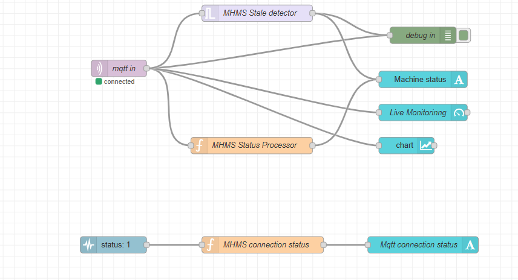
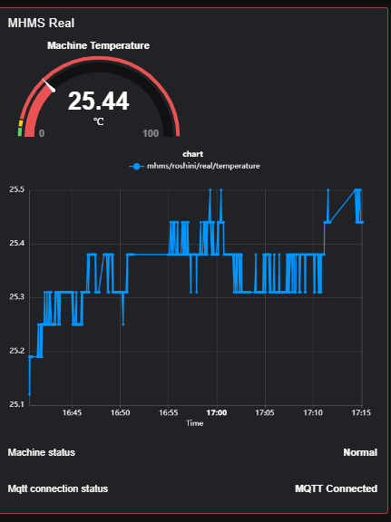

# Machine Health Monitoring System (MHMS) — V1

## Project Overview
MHMS is an IoT-based project that monitors machine temperature using an ESP32 and a DS18B20 temperature sensor. Temperature readings are transmitted through MQTT, displayed on a Node-RED dashboard, and stored locally using Python and SQLite.

## Technologies Used
- ESP32
- DS18B20 Temperature Sensor
- MQTT
- Node-RED
- FlowFuse Dashboard 2.0
- Python
- JSON
- SQLite

## System Workflow
1. The DS18B20 sensor measures temperature.
2. The ESP32 publishes temperature readings through MQTT.
3. Node-RED receives the readings and displays them on a dashboard.
4. A Python MQTT subscriber receives readings and processes them as JSON records.
5. SQLite stores the temperature readings with device information and timestamps.

## Features
- Real-time temperature monitoring
- MQTT-based communication
- Live dashboard visualization
- Temperature status indication
- Stale-data detection
- MQTT connection-status monitoring
- Local database storage using SQLite

  
## Project Screenshots

### Node-RED Flow

### Live Monitoring Dashboard

## Project Status
Version 1 — Core temperature monitoring and data storage workflow implemented and tested.

## Privacy Note
The live SQLite database and Python virtual environment are excluded from this repository.

## Future Improvements
- Add historical data analysis
- Introduce configurable temperature thresholds
- Explore machine health alerts and predictive maintenance 
